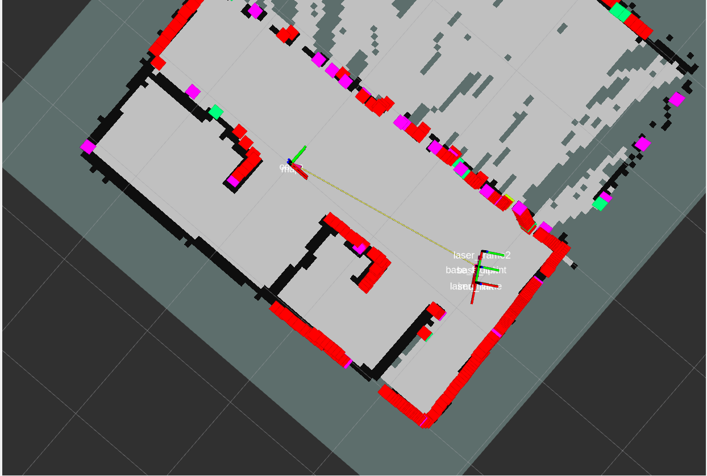

# dual_lidar_merger

A ROS 2 Humble package that **merges two YDLidar X2 `LaserScan` streams into one 360° `/scan_merged` topic**, with a built-in **footprint filter** that removes points hitting the robot's own chassis, standoffs and wires.

Both LiDARs must be mounted on the **same horizontal plane**.


*Map built with SLAM using `/scan_merged` as the only laser input.*

## How It Works

```
/scan  (laser_frame)  ──┐
                        ├──► [dual_lidar_merger_node] ──► /scan_merged (base_link)
/scan2 (laser_frame2) ──┘
```

1. Each scan is transformed into `base_link` using TF.
2. Points inside the robot footprint box are discarded.
3. The remaining points are binned by angle (0.5° default). Where both LiDARs see the same angle, the `overlap_mode` (`nearest` / `farthest` / `average`) picks the value.
4. The merged scan is published on `/scan_merged`.

All settings are in [`params/merger_params.yaml`](params/merger_params.yaml).

## YDLidar SDK

The merger itself needs only standard ROS 2 packages. The SDK and driver are needed only for `dual_lidar_full.launch.py`, which also starts both LiDAR drivers.

```bash
# YDLidar SDK
git clone https://github.com/YDLIDAR/YDLidar-SDK.git
cd YDLidar-SDK && mkdir build && cd build
cmake .. && make -j$(nproc) && sudo make install

# ROS 2 driver
cd ~/ros2_ws/src
git clone -b humble https://github.com/YDLIDAR/ydlidar_ros2_driver.git
```

## Build & Run

```bash
cd ~/ros2_ws/src
git clone https://github.com/VaibhaviDarda/dual_lidar_merger.git

# Install dependencies
cd ~/ros2_ws
rosdep install --from-paths src --ignore-src -r -y

# Build
colcon build --packages-select dual_lidar_merger --symlink-install
source install/setup.bash
```

**Launch**

```bash
# Drivers + merger (needs YDLidar SDK + driver)
ros2 launch dual_lidar_merger dual_lidar_full.launch.py \
  lidar1_port:=/dev/ttyUSB1 lidar2_port:=/dev/ttyUSB0 rviz:=true

# Merger only (LiDAR drivers already running)
ros2 launch dual_lidar_merger merger_only.launch.py

# RViz only
ros2 launch dual_lidar_merger view_merged.launch.py
```

## License

Apache-2.0
